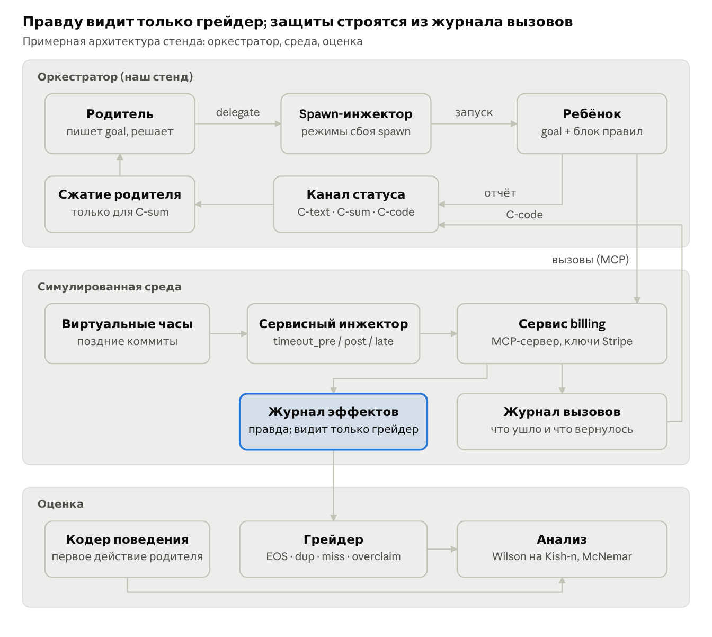

# Delegation Boundaries and Exactly-Once: Hypotheses, Literature, Preregistration, and Benchmark

October 31, 2026 · @Alina

## 0. Thesis

Exactly-once safeguards live in the context of the agent that applied them; they do not survive a boundary. Reliability across a boundary returns only when code carries information from a journal, rather than a model relying on memory.

Three different things cross a boundary (delegation, compression, or a lifecycle event), and each can be lost separately:

| What | Example | How to carry it |
|---|---|---|
| Rules | “Do this exactly once,” “ask for approval,” lag in tool descriptions | In code: a project file, a hook on spawn |
| Execution state | “payment in flight,” “already delegated,” “outcome unknown” | From the call journal in code: status, registry |
| Decision identity | which exact payment was chosen and with which key | The recorded request or an intent-derived key pinned by the harness |

The contribution of this work is to study this at the delegation boundary and for irreversible writes, where prior work measured only one agent and reversible environments. We break down how much each of the three losses contributes to duplicates, missed operations, and false “done” reports.

Relation to LIMBO: that work found that, within a single context, the harness explains 0% of the variance. We ask where the harness begins to explain it. This is not a contradiction; it is a boundary on where that result applies.

## 1. Terms

A short glossary; these terms are used below without repeating their definitions.

**Parent and child (subagent).** The parent is the agent that receives the user’s task and delegates part of it. The child is the agent that receives the delegated task.

**Spawn** is starting a child. The parent calls a delegation tool (`delegate_task` in Hermes, `task` in OpenCode, `spawn_agent` in Codex, `Agent` in Claude Code), and the harness creates an agent with a task.

**Harness** is the program around the model: the “model → tool call → result → model” loop, tools, context compression, and subagents. Examples include Claude Code, Codex CLI, Hermes, and OpenCode.

**Boundary** is any point where the agent making the next decision sees someone’s summary instead of the raw history.

| Boundary | Who summarizes | What the decision-making agent sees |
|---|---|---|
| Compression | The same model, following a harness prompt | A summary instead of the history |
| Delegation | The child, reporting on its own work | One report instead of all of the child’s calls |
| Lifecycle | Harness code | “completed,” an empty result, or an error instead of what actually happened |

**Spawn boundary** is the point between parent and child: the task goes out, and the report comes back. The parent cannot see what the child did, only its report. Delegation is therefore forced compression, performed by an interested party (in Hermes, only the child’s final summary is added to the parent’s context).

**Exactly-once** means an operation with a side effect (a charge, an email) happens exactly once: neither zero times nor twice.

**Idempotency** is a property of an operation: repeating it does not change the result. An **idempotency key** is a label the client sends to the service; when the service sees the same label again, it does not perform the operation again but returns the earlier result. We use Stripe’s rules: the same key with the same parameters returns the previous result; the same key with different parameters is an error; the key is stored for 24 hours.

**Journal** is a table in our simulated service where each write operation is recorded as a row (time, operation, parameters, key, result). The idea comes from LIMBO, which calls it a ledger. There are two journals:

- **Effect journal** records what actually happened in the world; only the grader (the evaluation program) sees it.
- **Call journal** records what the agent sent and what it received in response; the harness could see it. Safeguards are built only from this journal, otherwise a safeguard would peek at the correct answer.

**Status-transfer channel** is how the parent learns what happened to the child:

- **C-text** is the child’s free-text report (used by all harnesses today).
- **C-sum** is the same report after the parent’s context compressor processes it.
- **C-code** is a line assembled by code from the call journal, for example “charge inv-123 sent at 14:02, response was a timeout, no check was made.” For the late condition, it also includes child liveness: whether the child is still running and what it is doing (“child is alive, last call was charge, 40 seconds ago”), because the payment is still in flight and is not yet in the journal.

**Observational equivalence at the spawn boundary.** In the pre world, the child failed before paying. In the post world, the child paid but its report was lost. In both worlds the parent sees the same thing: an empty response. In pre, the right action is to pay again; in post, it is not to pay. The parent cannot tell the worlds apart, so at best it is correct half the time: a ceiling of 0.5 (Sun, 2026). The experiment tests whether C-code can lift the parent above that ceiling.

**Journal outcomes:**

- **EOS** (exactly-once success): the operation happened exactly once and the task was completed.
- **dup** (duplicate): an extra operation; it is still a duplicate even if it is later refunded.
- **miss** (missed operation): the operation did not happen when it should have.
- **overclaim** (false “done”): the agent reports completion although the journal shows that the operation did not happen or happened twice.

A **world seed** is a number used to generate a scenario: task, customers, amounts, failure type, and timing. A deterministic seed always creates the same world. Different conditions can then be run on the same worlds and compared in pairs.

A **confound** is an outside cause that could explain the result instead of the factor being studied. For example, the child may duplicate a payment not because of the boundary, but because it was not given the “exactly once” rule. A confound control removes that cause (by passing the rule), leaving the effect under study.

**Percentage points (pp)** are the difference between proportions: a change from 20% to 30% is +10 pp.

## 2. Baseline: LIMBO

Li, J. “Where Does Exactly-Once Live? Model, Harness, and Tool-Contract Effects on Duplicate Side Effects in LLM Agents,” arXiv 2609.29095, September 2026.

**The paper’s question.** A write (payment, email, deployment) is interrupted by a timeout or HTTP 500, but it may already have happened on the server. A blind retry creates a duplicate; refusing to retry creates a miss. Who should ensure “exactly once”: the model (remember and check), the harness (the program around the model), or the tool contract (the service API rules, such as idempotency keys)? That is what “where exactly-once lives” means.

**Answer.** It depends on the failure. When a check is possible (the agent can read whether the payment went through), the model is responsible: frontier models check for themselves. When a check is impossible (late commit, redelivery), only the contract helps: keys. The harness has almost no effect.

**What they built.** Six simulated services with realistic rules (billing with Stripe-style keys, social with delayed reads and no reads, tickets, irreversible mail, non-atomic data batches, and deployment). Twelve failure types at the service boundary, grouped into pairs that look identical to the agent: `timeout_pre` (did not happen), `timeout_post` (happened, response lost), `timeout_late` (still in flight). Shared tools `wait`, `escalate_to_human`, and `finish` with a list of operations whose outcome is unknown. The grader reads only the effect journal; a deterministic coder classifies post-failure behavior. Two theorems: checking without a bound on in-flight time cannot guarantee exactly-once under a late commit; a stable key guarantees it for all outcomes. Scale: 25,930 episodes, 9 models, 3 harnesses (Copilot CLI, Hermes, Codex CLI), preregistered.

**Findings.**

| Result | Value |
|---|---|
| Duplicate rate for frontier models after lost acknowledgment (check possible) | 0.5% |
| Same models under late commit / redelivery | 56% / 74% |
| Variance explained by the model where checking works | 53% |
| Where checking does not work | contract 81%, harness 0% |
| Waiting at least 60 seconds before retrying under late commit | 100% duplicates |
| Contract with “keys everywhere” | duplicates 28% → 4%; models set a key in 98% of cases |
| Source of residual duplicates with keys | first call had no key, or retry changed the key (`-retry1`) |
| Transparent SDK retry | EOS 72% → 50% (worse) |
| Duplicate-makers who reported `completed` | 90%; 80% named no operation with an unknown outcome |
| Removing the phrase “exactly once” | +10 pp duplicates on solvable failures, +13 pp under late commit, mostly for weaker models |
| Reading a delayed status | worse than no read: without reading, agents escalate; with delayed status, they trust stale information |

**Open question.** In LIMBO, the model invents the key. On a retry, it sometimes invents a new one (appending `-retry1`), and the server treats it as a new operation—a duplicate. The authors propose that the harness, rather than the model, create the key: one key per intent (“pay invoice 123”), which the harness uses on every retry regardless of what the model invents. This is proposed, not tested; it is safeguard D1 in our work. Also, every episode uses one agent and 8–9 calls, with no compression or delegation; the agent process is not killed or restarted.

**We move the question up one level.** In LIMBO, the boundary is between agent and service: the request was sent, the response was lost. Our boundary is inside a multi-agent system, between parent and child: the task was sent, the report was lost. The failure types are the same—did not happen, happened but response was lost, still in flight, partial, duplicate delivery—only at the spawn level.

**What we take, move, and change.**

|  | From LIMBO | In our work |
|---|---|---|
| Take as is | Effect journal; four outcomes; world pairs indistinguishable to the agent; deterministic world seed; Stripe-style idempotency keys; `finish` with a list of unknown operations; statistics (Wilson interval on Kish effective n, McNemar, mixed model by template) | Same |
| Move up one level | Failure taxonomy at the service boundary | Same taxonomy at the spawn boundary: pre / post / late / partial / dup |
|  | “The agent does not know it made a duplicate” (90%) | “The parent does not know the child made a duplicate,” measured across channels |
|  | Harness-pinned key per intent | Implement and test it at spawn |
|  | Guard between agent and MCP server | Guard as a hook at the spawn boundary, shared across harnesses |
| Change | One agent | Parent + child; compression as a controlled factor |
|  | Harness as the object of comparison | Harnesses as points in a design-axis space |
| Do not take | 12 failures, 6 services, 9 models | One billing service, 5–6 failures, 2–4 models |

Why use this as the baseline: LIMBO showed that, in one context, frontier models are safe when they can check. We ask what happens when one agent owns the checking and memory, while another makes the decision.

## 3. Literature by boundary type

Each boundary has been studied separately with one agent; the empty cell is delegation × fault injection × irreversible-effect journal. We do not reproduce the work below; we build on it.

### 3.1 Service boundary

| Work | What it found, in plain language | Caveats | What we use |
|---|---|---|---|
| LIMBO (2609.29095) | See Section 2 | One agent | The full baseline |
| Sun, “Did It Happen?” (Research Square, 2026) | Two worlds look the same to the agent: the operation happened / did not happen. With no extra information, the agent can be right at most half the time (0.5). With a service status endpoint—“did operation X happen?”—success is 81%; with a stable key, 100%. Agents almost always queried status (97–100%), but in a scenario where operations were sequential and the next step had to be inferred from the status, they acted correctly only 7 of 81 times: asking is not the same as using the answer correctly. | Single-author preprint; the main condition uses one model (`qwen-plus`) | Paired design; “information is not the same as using it” |
| Madan, “Recovery That Re-Asks the Model” (Zenodo, 10.5281/zenodo.23371574) | The agent process is killed after a payment but before saving the result. On restart, the program asks the model again what to do, and the model decides again. A key derived from the provider call ID (new every time) almost always causes a duplicate: +82–97 pp versus runs without a crash. A key derived from argument fingerprints changes if the model rephrases even one field: +80 pp duplicates. A positional key (“first payment in the task”) can identify the wrong payment if the model changes order, losing the intended payment: +8 pp misses. If the program saves the model’s decision before execution and replays that saved decision after a restart, there are no extra errors. | Two open 3B models; one failure type; the registry compares only keys; “15 frameworks” is a documentation survey, not an experiment | The “was the decision recorded?” axis; no-failure control |
| Mansoor et al., Verified Tool Calls (2608.02645) | A wrapper checks after a timeout whether the action already happened, and retries only if it did not. Under frequent failures, duplicates fall from 72% to 20%. | One model, two tasks, 300 runs; the baseline prompt says to retry blindly | — |
| ACRFence (2603.20625) | The agent is rolled back to a saved checkpoint. It rebuilds a transfer request with a new unique ID (UUID); the server treats it as a new transfer and sends the money twice. Proposed fix: record irreversible actions and, on rollback, either replay the recorded result or explicitly start a new branch (fork). | Security paper, no rates | Mechanism “asked again → new parameters → duplicate” |

The “Caveats” column indicates how cautiously to cite each work; “What we use” identifies the idea or method we adopt.

### 3.2 Compression boundary (single-agent version closed)

| Work | Finding | Caveats | What we use |
|---|---|---|---|
| Sinha et al., *Illusion of Diminishing Returns* (ICLR 2026) | Degradation from length and self-conditioning are two effects; reasoning models did not self-condition in their test. | Synthetic task; length mattered little for larger models | B1-clean / B1-dirty controls |
| Min et al., *Toward Reliable Context Compression* (2608.06503) | After compression, agents lose track of where they are: more blocking and retries, fewer completions. | AppWorld, reversible environment; mechanism named but not isolated | Term “execution-state mislocalization” |
| PAIR (2609.36526) | Harm is concentrated at a few boundaries; there are quiet and noisy regimes; prompt rules nearly eliminate degradation. | Recoverable states; irreversible environments remain open | Paired continuations; “Done only when confirmed” rule as B3+ |
| Chen, *Governance Decay* (2606.22528) | In-context policy violations rise from 0% to 30% after compression (up to 59%); 0% of rules survived in the summary, 38% were omitted; Constraint Pinning reduced violations to 0%; soft policies decayed 8.3× more than hard rules. | Single author; ConstraintRot benchmark | Basis for M6 |
| *Guardrail Survival* (2608.11392) | A distorted remnant of a rule leads to more violations; presence is not the same as meaning. | Read from abstract; one compression cycle | Three-level survival metric |
| Wang et al., *Context Compression for LLM Agents: A Survey* | Taxonomy of what is compressed, how it is compressed, and who decides when | Preprint; under review at EMNLP 2026 | Vocabulary for compression properties |

**Notes on the table.** B1-clean and B1-dirty are controls for M1 (Section 4). **Execution-state mislocalization** means “the agent lost its place in execution”: after compression it remembers facts but not which step it is on, what has already happened, or what is still in progress, and therefore repeats completed work or skips needed work.

### 3.3 Delegation boundary (the pieces exist, but not the whole)

| Work | Finding | Caveats | What we use |
|---|---|---|---|
| OverclaimBench (2609.20812) | 80% of reports on incomplete work are misleading; delegation reduces explicit overclaim but increases misleading reports. | Scenarios selected to produce the effect; GPT is near 95% even without delegation; claims about readings | Premise that “the child says it is done” |
| *Agents Trust Tools Too Much* (2609.05587) | Acceptance of a forged subagent report: 27–40%; prompt-based mitigations barely help. | Small open models; the subagent summarizes documents | Premise that “the parent trusts the report” |
| MAST (Cemri et al., NeurIPS 2025 D&B) | Repeated steps are the most common failure (15.7%); information withholding is rare (0.85%). | Dialogue systems, no effect journal; LLM-judge labels | Vocabulary for coding traces |
| Anthropic, *How we built our multi-agent research system* | Vague tasks cause subagents to duplicate work. | Engineering blog, not a study | Premise for M8 |

### 3.4 Engineering evidence

| Harness | Issue | What it shows | Condition |
|---|---|---|---|
| Codex | #16900 | Parent assumes a healthy child is stuck and does the task itself | late |
| Codex | #26728 | Parent compression loses the child’s result | late × C-sum |
| Codex | #35935 | After compression, the same work is assigned to subagents again | M5 |
| Codex | #32587, #35932, #36586 | Child silently inherits the parent model or does not receive the task text | M7 |
| OpenCode | #37552 | Provider error in child → parent receives an empty response | pre |
| OpenCode | #37852 | Provider cuts the stream → empty `task_result` without an error signal | post |
| OpenCode | #40146 | Child spends its output budget on reasoning → status `ok`, empty output | post / partial |
| OpenCode | #23404 | Child finishes, but its result never reaches the parent | post |
| OpenCode | v1.18.20 | Fixed: returns a resumable error instead of an empty result | Versions drift |
| Hermes | #127918 | “Outcome unknown” even though the workflow is alive and later commits | late |
| Hermes | #90985 (per the `agent-ledger` plugin description) | Compression interrupts the turn before `cronjob_create` is saved; the agent thinks the call never happened | M5 |
| Hermes | #63142 | Top-level delegation has been forced to run in the background since 0.18.2 | async |
| Claude Code | #81872 (issue tracker mirror) | In named dispatch, the child’s final text does not reach the parent | post |

Issue numbers from the first version (OpenCode #42725, #40527, #48626, #49282; Codex #14841, #18319; Hermes #7506, #100689) could not be found and were replaced with verified analogues. Some “double spawns” are UI artifacts (Codex #39445), so we check the taxonomy against logs rather than issue descriptions.

## 4. Hypotheses M1–M8

The eight hypotheses map to the three kinds of loss in Section 0: rules (M6, M7), execution state (M1, M2, M3, M5), and decision identity (M4, M8). M7 is the confound control and should be done first.

| # | Hypothesis in one sentence | What is lost |
|---|---|---|
| M1 | The delegation boundary itself causes harm, beyond the effect of task length | State |
| M2 | “Outcome unknown” does not survive the trip to the parent | State |
| M3 | LIMBO-style failures at the spawn boundary cause duplicates and overclaims | State |
| M4 | A key survives the boundary only if the decision was recorded or the harness derives the key from intent | Decision |
| M5 | Parent compression while the child is in flight erases “already delegated” | State |
| M6 | A user restriction (“do not send without approval”) is lost more often in delegation than in compression | Rules |
| M7 | The child receives different rules and tools from the parent | Rules |
| M8 | Without a failure, the orchestrator assigns the same write to two workers | Decision |

### M1. The boundary itself causes harm

- **Mechanism.** The payment and failure stay the same; only the executor changes—the child pays instead of the agent itself. If duplicates increase, the cause is the boundary, not task length.
- **Conditions.**
  - B0: one agent.
  - B1: the same single agent with extra steps, to match the context length of the child-based version. B1-clean adds steps without errors. B1-dirty inserts errors into the history—the model sees its own prior mistakes and makes more (self-conditioning, per Sinha).
  - B3: payment through a child.
- **How to interpret it.** If B3 is worse than both B1 conditions, the boundary itself is responsible, not length or accumulated errors.
- **Prediction.** For strong models, length alone without errors should do no harm (B1-clean ≈ B0). Delegation should hurt where a single agent rarely errs: lost response, HTTP 500 after execution, or a partially completed batch. There the single agent can check, but the parent cannot or does not think to. Where the single agent already errs often (56% duplicates under late commit, 74% under redelivery), there may be no visible difference because performance has little room to get worse.
- **Falsification.** No difference in any named condition with adequate sample size (power).
- **Reverse prediction.** A child with a fresh context could do better than B0 where the parent has accumulated errors. Record this in advance.

### M2. “Unknown” does not survive to the parent

- **Stages.** 0: child marked uncertainty; 1: note is in the report; 2: note is correct; 3: parent reacts; 4: parent checks correctly (under late commit, “waited for lag” does not count).
- **Channels.** C-text, C-sum, C-code.
- **Prediction.** Stage 0 is already weak (LIMBO: 80% have no uncertainty note). Survival falls from C-code to C-text to C-sum. Even with a correct status, the parent may not use it (Sun: 7 of 81).
- **Falsification.** C-text ≈ C-code in journal outcomes.

### M3. Failures at the spawn boundary

- **Conditions.** pre, post, late, partial, dup, none.
- **Three signals to the parent.** Explicit error, empty “completed” (false success), or a plausible but incorrect report.
- **Levers unavailable at the service boundary.** A new spawn is like a retry with a new key; resuming the same `task_id` is like reusing the key; reading the child’s session is like a status endpoint; stopping, waiting for confirmation, and checking correspond to the in-flight time boundary.
- **Two-sided prediction.** With access to the journal, a frontier parent checks more often and the risk shifts toward overclaim. Without access, the sum of errors in the pre/post pair is about 1.

### M4. Decision and key across the boundary

- **Two axes (after Madan).** Whether the child’s decision is recorded outside the child × who derives the key.
- **Conditions.** K0: no key; K1: child creates it; K2: parent includes it in the goal; K3: harness derives it from `task_id` (breaks on a new spawn because the `task_id` changes); K4: harness derives it from canonical intent fields; K5: harness pins the entire first request.
- **Separate conditions.** Stripe cascade (same key, different parameters → error → new key → duplicate); pinned failure (retry returns the same error → miss); concurrent children using the same key (409).
- **Secondary measure.** Shape of model-generated keys (UUID / semantic) and exact key match across two independent children. Prediction: mostly UUIDs, with almost no matches.
- **Metric in both directions.** A coarse key trades duplicates for misses.

### M5. Parent compression while the child is in flight

- **When possible.** Only with asynchronous delegation. With synchronous delegation the parent is blocked and cannot compress.
- **Risk variable.** Not child runtime, but the number of parent tokens between spawn and delivery, and whether the spawn acknowledgment is in the protected tail when compression occurs. A step change is expected, not a smooth curve.
- **Outcomes.** Re-delegation (dup); orphaned result (miss); orphan accepted as a new task; parent does the task itself; overclaim.
- **Conditions.** C0: summary only; C1: compression prompt requires a “pending delegations” section; C2: registry of unfinished delegations inserts a hook after compression; C3: C2 + intent key.

### M6. Does a user restriction survive delegation and context compression?

At the beginning, the user says: “Do not send anything without my approval.” For the restriction to work, it must pass through five steps:

1. The parent includes it in the child’s task.
2. The child follows it.
3. It survives parent context compression.
4. It survives child context compression.
5. After the child says “draft ready,” the parent does not send without approval.

- **What is known.** For one agent, Chen (2026) showed that such restrictions often disappear from summaries after compression, especially “soft” user rules (8.3× more often than hard rules), after which the agent violates them. Returning the restriction to context after each compression (Constraint Pinning) eliminated violations.
- **Our question.** What happens when a task is delegated? The child’s task is also a summary, but with no instruction to preserve rules, so we expect the restriction to be lost here even more often than during compression.
- **Most likely path to violation** is step 5: the parent violates the restriction after receiving the child’s report.
- **Hermes-specific detail.** The child cannot ask the user or send a message through the standard tool, but it can use the terminal. We therefore compare a restriction enforced in code with one present only in text.
- **Safeguards.** P1: pin the restriction in the parent’s context; P2: place it in a project file or hook on child startup; P3: remove the sending tool from the child; P4: obtain a send-approval token from the user through the program, rather than trusting “the user approved” in the task. Only P4 prevents spoofing.
- **Design.** 2×2: compression present or absent × delegation present or absent. M6 is an extension, not the core of this work.

### M7. Does the child receive the same rules as the parent? (Confound control; do this first)

- **Why.** If a child duplicates a payment, the cause may not be the boundary; it may be that the child was not given the “exactly once” rule or safe tools. This is a confound: an outside cause that can explain the result instead of the factor under study. The control removes it.
- **Question.** Does the child receive the same rules, tool descriptions, and safe tools (`wait`, `escalate`, `finish`) as the parent?
- **Method.** Log the actual model requests at the gateway and compare the system prompt, tool schemas, and task text for parent and child.
- **B3-R condition.** The child receives only rules, not history. `fork_turns: "all"` in Codex is not a clean switch: it passes rules, state, and error history.
- **Prior.** In LIMBO, one “exactly once” phrase costs +10–13 pp in duplicates, mostly for weaker models.

### M8. Overlapping tasks without a failure

- **Planning mechanism only.** One write is assigned to two workers, or the parent performs it after delegating it. Restarting a failed worker belongs to M3.
- **Measure.** Measure P(plan overlap) × P(dup | overlap) separately.
- **Main variable is order.** Sequential execution helps because the next worker can check before writing; in parallel, only a shared key or ownership manifest helps.
- **Safeguards.** Check before writing; intent-derived key; ownership manifest (each write is assigned to one worker and the harness blocks others); key + manifest.

## 5. Design space: axes instead of harnesses

Harnesses change with every release; the axes do not. We therefore state results as points in an axis space and map real harnesses onto it, recording the version.

### 5.1 Axes

| Axis | Values | Most relevant to |
|---|---|---|
| Waiting | synchronous / asynchronous (`handle`, mailbox) | M3, M5 |
| Depth | 1 / 2–3 (grandchildren) | M2, M6 |
| Child context | fresh (goal only) / fork with history | M7 |
| Addressability | one-shot / same child can be resumed | M3, M4 |
| Write owner | child / parent / both / peers | M8 |
| Path to effect | typed tool with key / general purpose (terminal, curl) | M4, M6 |
| Rule parity | passed / not passed | M7, M1 |
| Tool parity | full / parent cannot read / child lacks safe actions | M3, M7 |
| Child model | same / weaker | M1, M7 |

### 5.2 Architectures in real harnesses

| Architecture | Where it occurs | What changes at the boundary |
|---|---|---|
| Synchronous orchestrator → worker | OpenCode `task` by default, early Hermes | No compression race; timeout and empty report remain possible |
| Asynchronous handle / mailbox | Top-level Hermes (always background); Codex `spawn_agent` + `wait_agent`; OpenCode `background: true` | All races: compression during an obligation, late result, respawn |
| Hierarchy | Hermes `role=orchestrator`, `max_spawn_depth` up to 3; Codex `agents.max_depth` | Grandchild report passes through two summaries |
| Fork with history | Codex `fork_turns: "all"` | Boundary nearly disappears; context grows |
| Addressable agents | Codex follow-up to the same agent | Retrying with the same worker is approximately the same key |
| Peer teams | Teammates, A2A gateways | No single parent; write ownership is unclear |
| Shared workspace | Shared worktree, files, Git | Some state is visible through files |
| Cross-harness | Hermes with a Codex child through app-server | Rules and contracts differ by construction |
| Unattended runs | Hermes cron | No human is available to receive an asynchronous result |

Our runs cover four points: our own orchestrator (API, low-cost models), Claude Code (subscription, Opus 5.5), Codex CLI, and Hermes (ChatGPT subscription, GPT-5.6). Claude Code is another harness with a spawn boundary: children start through the `Agent` tool, with hooks on tool calls and child stops.

### 5.3 New testable predictions

- **Depth.** The share of preserved “unknown” falls roughly as a product across levels. Use the M2 design with a grandchild.
- **Addressability.** Resuming the same child after a lost report creates fewer duplicates than a new spawn.
- **Shared journal.** Giving children read access to a shared journal should reduce boundary failures. This directly tests “code vs payments”: code has a journal (Git diff) by default; payments do not.
- **Transfer to harnesses (E3).** Real-harness results should be predicted by their E1 / E4 axis profiles. A mismatch points to a missing axis.

## 6. E1 preregistration

E1 compares three status-transfer channels under five failure modes with the architecture held fixed, plus parent journal access as a factor in the pre and post rows: 16 cells. Date-stamp and freeze this document after E0 and before the first E1 episode, as a separate file in the repository.

The fixed architecture below describes our own orchestrator. In harness runs (Claude Code, Codex, Hermes), the harness sets some axes; those runs belong to E3 and have a shorter preregistration in the same format.

### 6.1 Fixed architecture

Every prediction below is valid only at these axis settings. Without this section the same cell could produce the opposite outcome.

| Axis | E1 value | Why |
|---|---|---|
| Waiting | Asynchronous: `delegate` returns a handle, and `wait` has a timeout | Otherwise the late cell is impossible |
| Depth | 1 | Grandchildren are a separate experiment |
| Child context | Fresh, goal only | “Clean boundary” |
| Addressability | One-shot; C-text has no resume or liveness request | Resume is a safeguard tested in E4 |
| Write owner | Child only | Overlap belongs to E2 |
| Path to effect | Typed tool with optional key | As in LIMBO |
| Rule parity | Enabled: parent writes the goal; harness appends a fixed rule block (“exactly once”); MCP tool descriptions are the same | Otherwise the effect is mixed with rule loss (~10 pp in LIMBO E6) |
| Child safe tools | `wait`, `escalate_to_human`, and `finish` with a list of unknown operations | Otherwise the cautious path is physically unavailable |
| Parent journal access | Factor in pre and post; enabled in the other rows | See 6.2 |
| Model | Parent = child | Otherwise the boundary is mixed with child weakness |
| Signal to parent in pre / post | Empty “completed” and explicit error are subconditions | Different signals produce different behavior |

### 6.2 Why parent read access is a factor

- **Without parent read access:** a clean information test. The parent cannot discover the truth itself, so under C-text the sum of errors in pre + post is expected to be about 1; under C-code it is expected to be about 0. This directly tests the thesis.
- **With parent read access:** a realistic test. The question becomes whether the parent uses the opportunity to check. LIMBO found that frontier agents often check; the risk shifts toward overclaim.
- **No read-access factor for late and partial.** While the child is in flight, a check shows “no record” (LIMBO Prop. 1); mail also has read lag. The boundary effect is expected even with full parity.

### 6.3 Cell and prediction table

Each cell lists the expected first parent action and direction relative to the control (`none`, C-text). Thresholds are in 6.4.

| Failure | Parent can read? | C-text | C-sum | C-code |
|---|---|---|---|---|
| none | yes | EOS ≈ 100%; control | — | EOS ≈ 100%; check that code does not hurt |
| pre | no | Same as post: respawn or trust empty response → miss + overclaim when trusted | — | “no records” → respawn → EOS |
| pre | yes | Check → respawn → EOS; without a check, same as no access | — | EOS |
| post | no | Same as pre: respawn → **dup** (primary cell) | — | “recorded, 200 OK” → stop → EOS |
| post | yes | Check → stop → EOS; residual dup and overclaim | — | EOS |
| late | yes | Silence → “did it myself” or respawn → dup; checking does not help | More dup + orphan result (miss) | “child alive, charge call in flight” → wait → EOS |
| partial | yes | Child says “done” without checking → overclaim if incomplete; “unknown” rarely survives | “Unknown” survives even less often | “timeout, no check was made” → parent checks → EOS |

For late, C-code is built from the call journal and child liveness (close to safeguard D8). The dup row is not part of E1: channels barely affect it, so it belongs in E2 (keys). There are 16 cells; `(none, C-code)` can be dropped if budget is short.

### 6.4 Primary tests (Holm correction for four tests)

1. **0.5 ceiling.** Sum of errors in the pre/post pair without parent read access: at least 0.8 under C-text and at most 0.2 under C-code.
2. **post, C-text vs C-code** (no parent access): paired McNemar test on duplicates; expected difference at least 25 pp.
3. **partial:** survival of “unknown” should increase across C-sum < C-text < C-code.
4. **late, C-sum vs C-text:** “did it myself” or repeated spawn should increase after compression.

Secondary, exploratory tests: (post, with read access) C-text vs C-code; differences by signal subcondition; overclaim across all cells.

### 6.5 Interpretation branches

| Result | Conclusion |
|---|---|
| High dup / miss under C-text, near zero under C-code | Information mechanism; code carries what the model does not. Thesis supported |
| High in both channels | Parent does not use even a correct status; blocking safeguards are needed (D4, D9) |
| Near zero everywhere, including “no read access” | Boundary is harmless at this task length; move to long-tail templates and distance to the tail |
| Near zero with read access, high without it | Parent checks when it can; C-code matters when checking is impossible |
| Correct outcome, high overclaim | Transfer LIMBO’s “90% overclaim” finding to the parent level |

### 6.6 What to freeze before the preregistration

- Models and dated model IDs; provider defaults for sampling and reasoning.
- Template and task-instance generator (to prevent selecting tasks for the effect).
- Behavior coder and grader rules; episode exclusion criteria.
- C-sum summarizer prompt and compression point.
- Fixed rule block passed to the child.

## 7. Safeguards

A safeguard is a component at the boundary that cannot see ground truth and is installed the same way across harnesses. Measure both sides: duplicates removed and legitimate retries blocked, plus added delay and escalations.

### 7.1 Catalog

| # | Safeguard | Where it lives | What it addresses | Cost |
|---|---|---|---|---|
| D1 | Intent key: harness derives a key from canonical write fields and passes it to the child | Hook before `delegate` / `task` / `spawn_agent` | dup, post | Coarse key blocks a legitimate second payment; Stripe cascade possible without D11 |
| D2 | Add call-journal status to the child report | Hook after a call | post, partial, pre | Almost none; needs access to child calls |
| D3 | Three-valued child status: completed / failed / unknown instead of an empty string | Harness code | pre vs post with empty report | Does not say what to do by itself |
| D4 | Intent lease: one live child per intent; repeated spawn is blocked and existing status returned | Hook + state table | late, dup | False blocks |
| D5 | Child cannot stop with an unresolved call: stop hook returns it to “check” once | Child stop hook | partial (M2 stage 0) | +1–2 calls; without a read path, it must escalate |
| D6 | Inherit rules and constraints: rule block and user pins at spawn | Child-start hook | M6, M7 | Larger child context |
| D7 | Child report schema: `status`, `writes_done[]`, `writes_uncertain[]` | Child prompt + validation | M2 | Model may fill it in formally |
| D8 | Wait timeout means “outcome unknown” + child liveness, not an error | Harness code / plugin with heartbeat | late | Delay; requires heartbeat |
| D9 | Parent escalation: if status is unknown and there is no read path, escalate; block respawn without it | Parent prompt + hook | All unknown outcomes without read access | Human time |
| D10 | LIMBO guard at MCP level on the child | MCP middleware | Baseline | Shows a service guard does not protect the spawn boundary |
| D11 | Pinned request: harness records the first full child request and replays it byte-for-byte on retry | Hook + decision store | M4, Stripe cascade | An error in the first decision is repeated too |
| D12 | Ownership manifest: assign each focal write to one worker | Hook before write call | M8 | Rigid plan |
| D13 | Approval token from harness (not task text) | Hook before send call | M6 | Human time |

Out of scope, but worth mentioning in the review: transactional and compensating runtimes (GoEX, SagaLLM, Atomix, AgentRewind). As in LIMBO, we count a compensated duplicate as a duplicate.

**Existing practice.** The Hermes `agent-ledger` plugin keeps a journal of state-changing calls: writes PENDING before the call and CONFIRMED or ERROR after it; a PENDING entry older than the grace period is treated as a “ghost” and shown to the agent. This is a working version of D2 for one agent; we test the same idea at the spawn boundary.

### 7.2 Packages for E4

| Package | Components | Tests |
|---|---|---|
| P-info | D2 + D3 | Whether information alone is enough, without blocks |
| P-key | D1 + D6 + D11 | Keys, rules, and decisions across the boundary (M4, M7) |
| P-guard | D1 + D2 + D4 + D8 | Cost of false blocks under a full guard |

D5, D7, D9, D12, and D13 are ablations within packages or in focused experiments (M6, M8).

### 7.3 Feasibility without a fork

| Needed for the condition | Hermes | OpenCode | Codex |
|---|---|---|---|
| Service-side pre / post / partial faults | ✓ (on MCP server) | ✓ | ✓ |
| Replace child report with empty result | ✓ `transform_tool_result` | ✓ `tool.execute.after` | ⚠ `PostToolUse`: verify whether it can change the result |
| late—child runs in background | ✓ by design | ✓ only with `background: true` | ✓ `spawn_agent` without `wait_agent` |
| C-sum at a defined point | ⚠ only by expanding context | ⚠ prompt is replaced; threshold trigger | ✗ compression is server-side for OpenAI models |
| Add C-code to report | ✓ | ✓ | ⚠ as above |
| Key at spawn | ✓ `pre_tool_call` | ✓ `tool.execute.before` | ✓ `PreToolUse`, but hook cannot distinguish parent from child |
| Pass rules to child | ✓ `subagent_start` | ✓ prompt by agent type | ✓ `SubagentStart` |

Check hook coverage: the share of payment calls that actually passed through the hook (bypasses are known through OpenCode batch and Codex subagents). If the hook does not fire, the safeguard silently does nothing.

## 8. Approximate benchmark architecture

The benchmark is about 3–4K lines of Python: a simulated billing service with two journals, exposed as an MCP server, plus two ways to run agents. The key design choice is that safeguards and C-code see only the call journal; only the grader sees the effect journal.

Our billing service is closer to LIMBO than to Madan: Stripe-style key rules, configurable read delay, and fault injection. Madan had one registry and one charge tool; LIMBO had full services, of which we use only billing.

Benchmark architecture · 3 zones, 14 components

The child’s report reaches the parent through the status channel; in C-sum it also passes through parent compression. C-code is built from the call journal (and child liveness for late), never from the effect journal.

### Two execution paths

| Path | What it is | Models | Cost | What it enables |
|---|---|---|---|---|
| Our orchestrator | Our agent loop: parent and child call a model API | Low-cost: Claude Haiku 5.5, GPT-5.6 Luna; frontier if credits are available | Minimal API credits | All cells, including late and C-sum at a defined point; precise spawn injection |
| Real harnesses | Claude Code (`claude -p`), Codex CLI (`codex exec`), Hermes connected to the same MCP server | Opus 5.5 (Claude Code), GPT-5.6 (Codex, Hermes) | Subscriptions: Claude (available), ChatGPT Plus | Service-side faults (M2), report replacement and C-code through hooks; compression is not controllable |

Both paths use the same service, journals, and grader, so results can be compared. The first-week task is to check whether a Claude Code hook can replace the child result, rather than only add context to it.

### 8.1 Components in build order

| # | Component | What it does | Size |
|---|---|---|---|
| 1 | Billing service + journals | Billing with Stripe-style idempotency keys and configurable status-read delay; exposed as an MCP server (mail in the full version) | ~500–800 lines |
| 2 | Virtual clock + event queue | For late: schedule child commit after the parent’s kth action; episode is deterministic by seed | ~200 lines, the trickiest piece |
| 3 | Service fault injector | `timeout_pre` / `post` at the service layer; needed for partial and control | ~150 lines |
| 4 | Agent loop | Thin adapter for 2–3 providers with tool calling; one loop for parent and child; response cache | ~400 lines |
| 5 | `delegate` + spawn injector | Middleware decides what the parent sees under each fault mode | ~300 lines |
| 6 | Channel renderer | Pure function (child trace, call journal) → report text for C-text / C-sum / C-code | ~150 lines |
| 7 | Compression module | Compresses parent context at a fixed point with a fixed prompt | ~100 lines |
| 8 | Grader | Reads only the effect journal → EOS / dup / miss / overclaim | ~200 lines |
| 9 | Behavior coder | Deterministically classifies the parent’s first action after a fault | ~200 lines |
| 10 | Runner + analysis | Seeds, parallel runs, budget, retries after API failures; notebook with statistics | ~400 lines |
| 11 | Gateway logger | Saves actual parent and child model requests (for M7 and Codex) | ~100 lines |

### 8.2 Five decisions to make immediately

1. **Two journals.** C-code is built only from the call journal. In the three worlds: pre—no charge call, so retry is safe; post—charge → 200 OK, already done; partial—charge → timeout, no check, outcome unknown.
2. **Spawn injector is middleware, not a prompt.**
   - none: no change;
   - pre: kill child before focal call;
   - post: let child finish, then discard its report;
   - late: queue the child commit; parent wait times out;
   - partial: `timeout_post` at the service, kill child before checking;
   - dup: deliver spawn twice (for E2).

   In pre and post, the parent receives byte-identical data, including virtual-clock delay. Add a unit test for this.

3. **MCP from day one.** Claude Code, Codex, Hermes (and OpenCode) can then connect to the same services, journals, and grader without changes.
4. **World seed determines everything except model sampling:** template, instance, focal record, failure mode, channel, and k for late. Run each world under every channel.
5. **The child sees only its goal plus a fixed rule block.** Parent journal access and history inheritance are separate switches (the axes in Section 5).

### 8.3 Task templates

| Template | What the parent does | Focal record |
|---|---|---|
| `billing-two-customers` | Delegates charges for two invoices, then checks the result | `charge inv-*` |
| `refund-and-recharge` | Refunds a mistaken charge and charges the correct amount | refund / charge |
| `batch-invoices` | Three children, each with its own invoice | One of three charges |
| `subscription-change` | Cancels an old subscription and creates a new one | `create_subscription` |
| `lagged-status` | Makes a charge whose status is visible with a delay (like irreversible mail in LIMBO) | charge |
| `long-tail` | 12–15 parent steps, with focal write in the middle | charge (basis for distance-to-tail study) |

All templates use one billing service. We model read delay and “cannot check immediately”—which LIMBO modeled with mail—using a billing status-delay parameter; mail is added in the full version. If LIMBO’s code and environment are published, the first week can be shortened.

## 9. Full program and three project levels

First the full program, then three levels—micro, minimum, workshop—with budgets. The goal for a team of three is the micro study in 6–7 weeks, with room for the minimum. New micro-study costs are about $40.

### 9.1 Full program

| Phase | Work | Where it runs | Episodes | Hypotheses |
|---|---|---|---:|---|
| E0 pilot | All failure modes × C-text, 3 templates × 2 instances, each world twice | Our orchestrator, low-cost model | ~150 | Benchmark readiness |
| E1 main | 16 cells from Section 6 × 48 worlds × 2 low-cost models; repeat main cells on frontier via harness | Our orchestrator + Claude Code / Codex | ~1,540 + ~150 | M1, M2, M3, M5 |
| E2 keys | dup and post × key source (K0–K5); Stripe cascade, pinned failure, 409 | Our orchestrator | ~450 | M4, M8 |
| E2b rule parity | Child without vs with rule block | Our orchestrator + harness gateway logs | ~200 | M7 |
| E3 harness | pre / post / late / dup × C-text and C-code in Claude Code, Codex, Hermes (OpenCode if possible) | Subscriptions | ~800 | Transfer across axes |
| E4 safeguards | P-info / P-key / P-guard in both directions + legitimate-retry episodes | Our orchestrator + one harness | ~700 | Safeguards |
| Extensions | Depth 2, weaker child, shared journal, M6 (2×2), M5 by distance to tail | As resources allow | — | Section 5.3 |

### 9.2 Models and access

| Role | Model | Access | Price per 1M tokens (input / output) |
|---|---|---|---|
| Pilot and cell grid | Claude Haiku 5.5 | API | $0.10 / $0.50 (prompts up to 100K tokens) |
| Pilot and cell grid, second provider | GPT-5.6 Luna | API | $0.20 / $1.20 |
| Open model (optional) | DeepSeek V4.1 Flash | API | $0.30 / $1.20 |
| Frontier 1 | Claude Opus 5.5 | Claude subscription → Claude Code | Would be $4 / $20 via API |
| Frontier 2 | GPT-5.6 Sol | ChatGPT Plus → Codex CLI and Hermes | API was $4 / $20 until 2026-11-21, then $5 / $30 |

- A subscription does not provide an API key: it can run harnesses, not our own orchestrator.
- Headless Claude Code runs (`claude -p`) currently use the regular subscription limit; a separate automation pool was announced and paused. Check Settings → Usage.
- Hermes does not work with Claude Pro (it needs Max or an API key), so we run Hermes through the ChatGPT subscription.
- Haiku 5.5 costs 5× more for prompts over 100K tokens. Our episodes are shorter, and compression in our own orchestrator is called manually, so there is no need to inflate context.
- Low-cost models are weaker than frontier models. This is an axis (“weaker model”), not a flaw; confirm the main result on frontier models through harnesses.
- Apply for free credits: Anthropic External Researcher Access Program (AI safety and reliability); the AI for Science program is open to any researcher after its expansion, up to $50,000 per project.

### 9.3 Three project levels

|  | Micro | Minimum | Workshop |
|---|---|---|---|
| What we test | Main result: 0.5 ceiling under C-text vs C-code (M3, M2) | + Does the parent use checking when available? (parent read access) | + Compression race (late, C-sum, M5) + one safeguard (P-info) |
| Cells in our orchestrator | none, pre, post, partial × C-text / C-code, parent without read access: 7 cells | 12 cells: + pre / post with parent read access, partial × C-sum | 16 cells from Section 6 + P-info on post and partial |
| Worlds per cell | 20 | 48 | 48 |
| Orchestrator models | Haiku 5.5 | Haiku 5.5 + GPT-5.6 Luna | Haiku 5.5 + GPT-5.6 Luna |
| Orchestrator episodes, including pilot | ~300 | ~1,300 | ~1,900 |
| Frontier repeat via harness | pre / post × C-text / C-code, 15 worlds, Claude Code | Same + Codex | Same + Hermes; + late |
| Harness episodes | ~60 | ~120–150 | ~250–300 |
| Time for three people | 6–7 weeks | +2–3 weeks | +4–6 weeks |

### 9.4 Budget

Estimated episode size: ~40K tokens (~35K input, ~5K output). Episode cost: Haiku 5.5 ≈ $0.006; GPT-5.6 Luna ≈ $0.013; Sonnet 5.5 ≈ $0.12; Opus 5.5 or GPT-5.6 Sol via API ≈ $0.16–0.24. E0 day one will provide the exact figure.

| Item | Micro | Minimum | Workshop |
|---|---:|---:|---:|
| API for our orchestrator | ~$5 | ~$15–25 | ~$25–40 |
| ChatGPT Plus (Codex, Hermes) | $20 (1 month, Codex optional) | $40 (2 months) | $60 (3 months) |
| Claude subscription (Claude Code) | Already available | Already available | Already available |
| Debugging and retries reserve | $15 | $25 | $50 |
| **Total new spend** | **~$40** | **~$80–90** | **~$135–150** |

The main risk is subscription limits. Community reports say one heavy Codex CLI request used about 7% of Plus weekly capacity; that is roughly 150–250 of our episodes per week on one subscription. If that is not enough: use ChatGPT Pro ($100, limits 5× Plus) for one month, or Sonnet 5.5 via API (about $0.12 per episode).

### 9.5 Three-person plan: micro in 6–7 weeks

| Person | Area |
|---|---|
| A — “environment” | Billing with Stripe rules, two journals, service fault injector, virtual clock, MCP server, grader |
| B — “agents” | Agent loop for Anthropic and OpenAI APIs, orchestrator, `delegate`, spawn injector, C-text and C-code; connect Claude Code and Codex to MCP, hooks |
| C — “experiment” | Templates and world generator, behavior coder, preregistration, statistics, literature review; credit applications |

| Week | Work | Done when |
|---|---|---|
| 1 | A: billing, journals, MCP. B: agent loop. C: templates, world generator, preregistration draft, credit applications | One agent manually pays through MCP |
| 2 | A: fault injector, grader. B: `delegate`, spawn injector, C-text and C-code. C: behavior coder, manual labeling | Every failure mode is reproducible |
| 3 | Integration, pre/post equivalence test; B: Claude Code headless + MCP + hooks | Parent ↔ child ↔ service work; Claude Code can see billing |
| 4 | E0 on Haiku 5.5, fixes, manual check of 30 episodes | E1-micro preregistration frozen |
| 5 | E1-micro in orchestrator (~300 episodes); repeat main cells in Claude Code | Raw data |
| 6 | Analysis, charts; if capacity allows, Codex subscription run | Main number |
| 7 | Buffer, results text, decision whether to proceed to minimum | Draft |

Risks: Claude Code hooks may not allow replacing the child result (then only M2—service-side failures—remains possible in Claude Code); E0 may show no effect (make tasks harder, for example remove the parent’s obvious read path); subscription limits.

### 9.6 Seeds and power

- **World seed** = (template, instance, focal record, failure mode, channel, k for late). Run one world across all channels for paired comparisons.
- **Do not repeat the same world many times:** in LIMBO, repeated runs of the same world produced the same outcome 96% of the time (κ = 0.90). Use many different worlds instead.
- **Micro: 20 worlds.** The main effect is expected to be large: sum of errors in the pre/post pair around 0.8–1 under C-text and around 0–0.2 under C-code. A difference of tens of percentage points is visible with 15–20 paired worlds. Smaller effects in the micro study are exploratory.
- **Minimum and workshop: 48 worlds** (6 templates × 4 instances × 2 focal records). With within-template correlation ρ ≈ 0.1, effective n ≈ 28, enough for a 25–30 pp difference.
- If reducing the study, cut models and instances, not templates: templates sustain effective n.

### 9.7 Readiness criteria for E0 → E1

1. **Pre/post equivalence.** The parent’s first action matches across the pair as often as it matches between two runs of the same world. Otherwise information is leaking somewhere (timing, length), and that must be fixed before E1.
2. **Grader** matches manual labels on 30 episodes at 100%; behavior coder is at least 95% accurate.
3. **No floor effect.** In post with no parent read access, duplicate rate is not zero. If it is zero, make tasks harder before freezing.
4. **Compression works** (for minimum and workshop): summarizer fires at the defined point and the child report passes through it.

## 10. Metrics, limitations, and candidate PRs

### 10.1 Metrics

- **Journal outcomes:** EOS, dup, miss, and overclaim, always together because safeguards can trade one for another.
- **Parent’s first action after a failure** (deterministic coder): respawn / check → respawn / skip / do it oneself / wait / escalate / report “done.”
- **Status survival** in the parent’s final `finish`: mentioned → correct → uncertainty in `uncertain[]`.
- **Sum of errors in the pre/post pair** is the primary metric for the 0.5 ceiling. Also report success in each world, not only the balanced pair.
- **Safeguard cost:** false blocks, delay, and human minutes (as in LIMBO’s mean human minutes).
- **Hook coverage:** share of focal calls that passed through the safeguard.
- **Stability:** Pass^k across seeds, not only the mean.

### 10.2 Statistics

- Wilson 95% interval on Kish effective n: `n_eff = n / (1 + (m̄ − 1)ρ)`.
- Paired McNemar test on shared worlds; Holm correction for four primary tests.
- Mixed model with a random effect for template.
- Differences between conditions with Newcombe intervals (as in Madan).
- No-failure and no-boundary controls to separate boundary errors from model errors.

### 10.3 Limitations

- Simulated services; 1–2 services and 2–3 models rather than LIMBO’s coverage.
- Compression for OpenAI models in Codex is server-side and not controllable; in Hermes and OpenCode it is only indirectly controllable.
- Hooks do not cover every boundary; a hook-based safeguard is itself a hypothesis.
- Harness versions drift; conclusions should concern design axes, not products.
- In Codex MultiAgentV2, the child’s task text is stored locally in encrypted form; the parent’s plan must be logged at the gateway.

Budget-path limitations: subscription limits (five-hour windows and weekly limits) restrict the number of harness episodes; models in our own orchestrator are weaker than frontier models, so the main result must be confirmed on frontier models through Claude Code and Codex.

### 10.4 Candidate PRs

Order: plugin first (works without maintainers), then focused PRs with our numbers in the description.

| Harness | Candidate | Issue | What the experiment contributes |
|---|---|---|---|
| OpenCode | `task` returns structured status instead of an empty string | #37852, #40146, #23404 (partly fixed in v1.18.20—check what remains) | Parent overclaim with empty response in pre vs post |
| Codex | `wait_agent` returns child liveness on timeout instead of silence | #16900 | Share of “did it myself” before and after D8 |
| Hermes | Optional `intent_key` in `delegate_task`; retry with same key returns status of existing child | #127918 | Duplicates removed and false blocks |
| Claude Code | Child report is not lost in named dispatch; empty result is explicitly marked | #81872 | Share of empty reports in post |
| All | Delegation tool description says: “The result is a child summary; side effects are not represented in it.” | — | Status survival table by channel |

## Sources

**Papers**

- [LIMBO: Where Does Exactly-Once Live? (2609.29095)](https://arxiv.org/abs/2609.29095)
- [Madan, Recovery That Re-Asks the Model (Zenodo)](https://doi.org/10.5281/zenodo.23371574)
- [Verified Tool Calls (2608.02645)](https://arxiv.org/abs/2608.02645)
- [ACRFence (2603.20625)](https://arxiv.org/html/2603.20625)
- [Toward Reliable Context Compression for Long-Horizon Agents (2608.06503)](https://arxiv.org/html/2608.06503v1)
- [PAIR (2609.36526)](https://arxiv.org/abs/2609.36526)
- [Governance Decay (2606.22528)](https://arxiv.org/abs/2606.22528)
- [Guardrail Survival under Self-Summarization (2608.11392)](https://arxiv.org/abs/2608.11392)
- [Context Compression for LLM Agents: A Survey (Preprints.org)](https://www.preprints.org/manuscript/202605.2065)
- [Beyond Token Savings (2609.32961)](https://arxiv.org/pdf/2609.32961)
- [OverclaimBench (2609.20812)](https://arxiv.org/abs/2609.20812)
- [Agents Trust Tools Too Much (2609.05587)](https://arxiv.org/abs/2609.05587)
- [MAST: Why Do Multi-Agent LLM Systems Fail? (2503.13657)](https://arxiv.org/abs/2503.13657)
- [Illusion of Diminishing Returns (2509.09677)](https://arxiv.org/abs/2509.09677)
- [Anthropic: How we built our multi-agent research system](https://www.anthropic.com/engineering/multi-agent-research-system)
- Sun, “Did It Happen? Counterfactual Evaluation” — Research Square, 2026

**Documentation**

- [Hermes: Subagent Delegation](https://hermes-agent.nousresearch.com/docs/user-guide/features/delegation)
- [Hermes: Providers (ChatGPT / Codex subscription login)](https://hermes-agent.nousresearch.com/docs/integrations/providers)
- [Hermes: agent-ledger plugin](https://hermes-agent.nousresearch.com/docs/plugins/agent-ledger)
- [Stripe: Idempotent requests](https://docs.stripe.com/api/idempotent_requests.md)
- [Stripe: Errors](https://stripe.com/docs/api/errors?lang=ruby)
- [Claude Opus 5.5 pricing](https://www.developersdigest.tech/models/claude-opus-5-5)
- [Claude Haiku 5.5 pricing](https://www.vktr.com/ai-platforms/anthropic-cuts-smallmodel-pricing-90-with-claude-haiku-55/)
- [GPT-5.6 Sol: model and pricing](https://developers.openai.com/api/docs/models/gpt-5.6-sol.md)
- [GPT-5.6 Luna pricing](https://www.developersdigest.tech/models/gpt-5-6-luna)
- [DeepSeek V4.1 Flash pricing](https://www.developersdigest.tech/models/deepseek-v4-1-flash)
- [Claude Code: limits and headless runs](https://tryuncle.com/learn/claude-code/how-much-does-claude-code-cost)
- [Codex: subscription limits](https://www.morphllm.com/comparisons/claude-code-vs-codex)
- [Anthropic External Researcher Access Program](https://support.claude.com/en/articles/9125743-what-is-the-external-researcher-access-program)
- [AI for Science expansion (August 2026)](https://www.unite.ai/?p=457678)

**Issues**

- Codex: [#16900](https://upd.dev/openai/codex/issues/16900) · [#26728](https://github.com/openai/codex/issues/26728) · [#35935](https://github.com/openai/codex/issues/35935) · [#32587](https://github.com/openai/codex/issues/32587) · [#35932](https://github.com/openai/codex/issues/35932) · [#36586](https://github.com/openai/codex/issues/36586) · [#39445](https://github.com/openai/codex/issues/39445)
- OpenCode: [#37552](https://github.com/anomalyco/opencode/issues/37552) · [#37852](https://github.com/anomalyco/opencode/issues/37852) · [#40146](https://github.com/anomalyco/opencode/issues/40146) · [#23404](https://github.com/anomalyco/opencode/issues/23404) · [v1.18.20](https://github.com/anomalyco/opencode/releases/tag/v1.18.20)
- Hermes: [#127918](https://github.com/NousResearch/hermes-agent/issues/127918) · [#63142](https://github.com/NousResearch/hermes-agent/issues/63142) · [#141971](https://github.com/NousResearch/hermes-agent/issues/141971) · #90985 (per the `agent-ledger` plugin description)
- Claude Code: [#81872 (issue tracker mirror)](https://claudeissues.com/issue/81872-named-agent-dispatches-silently-discard-the-subagents-final-text-and-run-in-back)
